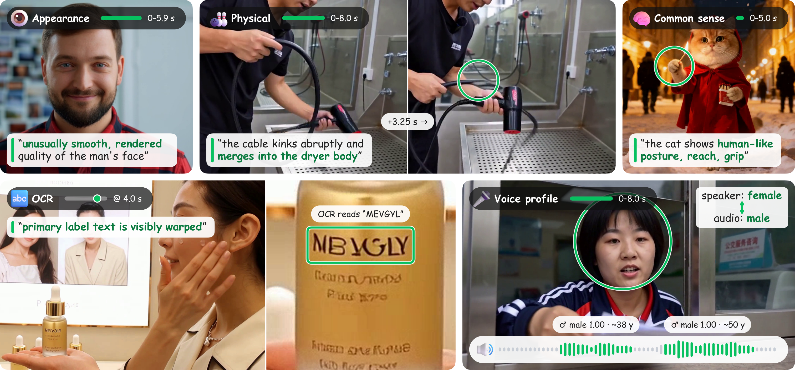
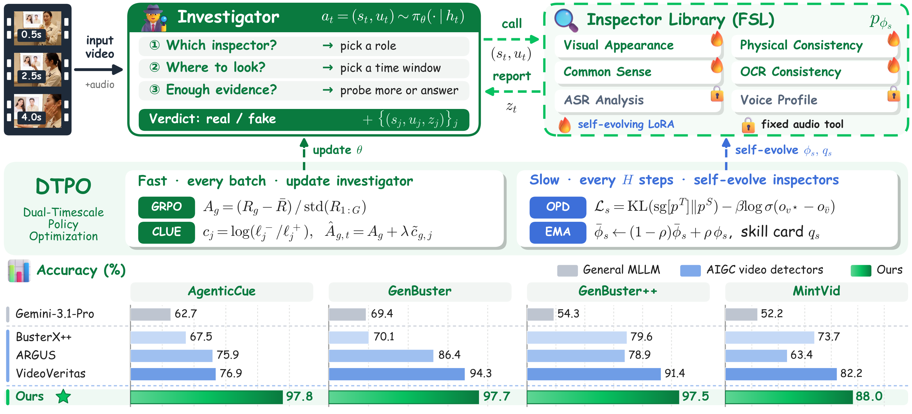
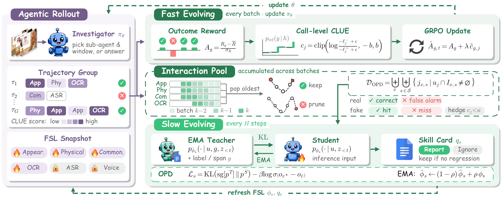

<div align="center">

# WeVisForensics

### 面向全模态 AI 生成视频检测的自进化 Agent

<p>
  <a href="https://tencent.github.io/WeVisForensics"></a>
  <a href="https://arxiv.org/abs/2611.21373"></a>
  <a href="https://huggingface.co/tencent/WeVisForensics"></a>
  <a href="LICENSE.txt"></a>
</p>

[English](README.md) | **简体中文**

</div>

> **WeVisForensics** 利用 Agentic 方法进行 AI 生成视频检测。主 Agent（**Investigator**）先浏览视频概览，再决定查哪类伪影、查哪一段、何时下结论。每一次检查都交给一个可自我进化的取证子 Agent 库（**Inspectors**），覆盖视觉外观、物理一致性、常识、画面文字和音频。



## ✨ 亮点

- 🕵️ **按需调查**：主 Agent 只在关键时刻调用视频真正需要的子 Agent，证据充分就立即结束。
- 🧰 **全模态子 Agent 库**：四个经过训练的视觉子 Agent，加上语音和说话人工具，同一个 Agent 就能发现外观异常、物理错误、违背常识的事件、扭曲的文字和音画不符的声音。
- 🔁 **自进化训练（DTPO）**：主 Agent 与子 Agent 从共同的交互中协同进化，主 Agent 用强化学习快速更新，子 Agent 慢速精炼。
- 🏆 **领先性能**：在域内、域外和 Agentic 基准上平均准确率 95.2%，比此前最强的检测器高 9.0 个点。

## 📢 新闻

- **[2026-11]** 🎉 我们发布 **WeVisForensics**：技术报告、4B LoRA 权重、推理代码和 Gradio 演示。

## 📝 TODO

- [x] 推理代码
- [x] Gradio 演示
- [x] 评测流程
- [x] arXiv 技术报告
- [ ] Hugging Face 模型权重
- [ ] AgenticCue 基准

## 🏆 性能一览

**WeVisForensics-4B** 与各基准上此前最强方法的检测准确率（%）对比。对比方法包括 Qwen3.5-397B、Gemini-3.1-Pro，以及 BusterX++、Skyra、VideoVeritas 等基于多模态大模型的视频伪造检测器。

| 划分 | 基准 | Best Baseline | **WeVisForensics** |
| --- | --- | --- | --- |
| 🏠 域内 | GenBuster-Bench | 94.3 | **97.7** |
| 🌍 域外 | GenBuster-Bench++ | 91.4 | **97.5** |
| 🌍 域外 | MintVid General | 82.2 | **88.0** |
| 🧩 Agentic | AgenticCue | 79.3 | **97.8** |
| ⭐ | 平均 | 86.2 | **95.2** |

<sub>每行取该基准上最强的此前方法。平均一行取此前方法中最高的四项平均值。</sub>

完整结果见[英文 README](README.md#-performance-at-a-glance)。

## 🏗️ 方法



**1. 主 Agent。** 读取 1 FPS、最多 16 帧的概览，每一步输出一个 JSON 动作：在某个时间窗上调用一个子 Agent，或者回答 `real` / `fake`。它读完每次的观察再决定下一步查什么，五步之内给出结论。

**2. 取证子 Agent 库。** 每个子 Agent 专注一类伪影，以 2 FPS 解码自己的时间窗，返回判断、置信度和一段描述所见的简短报告。

| 子 Agent | 输入 | 检查内容 |
| --- | --- | --- |
| 🎨 `visual_appearance` | 一个时间窗 | 纹理、边界、闪烁、光照 |
| ⚙️ `physical_consistency` | 一个时间窗 | 运动、人体结构、接触、材质 |
| 🧠 `common_sense` | 一个时间窗 | 因果、可供性、事件顺序 |
| 🔤 `ocr_consistency` | 一个时刻 | 先检测文字，再逐个裁剪检查字形 |
| 🗣️ `voice_profile` | 音轨 | 说话人的年龄、性别、情绪是否与画面中的人相符 |
| 📝 `asr_analysis` | 音轨 | 转写内容与时间是否合理 |

**3. 双时间尺度协同进化（DTPO）。** 交互同时反馈给两层：主 Agent 通过强化学习快速更新，按调用给出信用，学会哪些检查值得做；子 Agent 在标注的伪影区间引导下慢速精炼，学会报告以前忽略的细微伪影。



## 🚀 快速开始

### 安装

```bash
git clone https://github.com/Tencent/WeVisForensics.git && cd WeVisForensics
conda create -n wevisforensics python=3.10 -y && conda activate wevisforensics
conda install -c conda-forge ffmpeg -y
pip install -r requirements.txt && pip install -e .
```

WeVisForensics 提供三种部署方式。多卡部署为每个子 Agent 单独起一个 vLLM 服务，适合大规模评测。单卡部署把所有角色放在一张卡上，最适合本地上手体验。Transformers 部署不依赖 vLLM，Gradio 演示和 Hugging Face Space 都用这一种。

### 方式一：多卡部署

合并 LoRA，每个子 Agent 各占一张卡，主 Agent 在进程内加载：

```bash
python scripts/merge_lora.py --base Qwen/Qwen3.5-4B \
  --adapters weights/WeVisForensics-4B-LoRA --output weights/WeVisForensics-4B-merged

MODEL_ROOT=weights/WeVisForensics-4B-merged ASR_MODEL=Qwen/Qwen3.5-4B \
  GPUS=0,1,2,3,4 bash scripts/serve_full.sh
```

把 `configs/multi_server.json` 里的 `engine.model` 指向 `weights/WeVisForensics-4B-merged/main`，然后运行：

```bash
python scripts/infer.py demo/examples/c04559bab78f9a8b5b7e.mp4
```

更多细节见 [docs/deployment.md](docs/deployment.md)。

### 方式二：单卡部署

主 Agent 和所有子 Agent 共享一份基座模型，在同一个 vLLM 进程中切换各自的 LoRA，无需合并。一张 24 GB 显卡就够用：

```bash
BASE=Qwen/Qwen3.5-4B ADAPTERS=weights/WeVisForensics-4B-LoRA \
  GPU_MEMORY_UTILIZATION=0.66 bash scripts/serve_lora.sh

python scripts/infer.py demo/examples/c04559bab78f9a8b5b7e.mp4 \
  --config configs/lora_single_server.json --main-backend http
```

### 方式三：Transformers（Gradio 演示 / Hugging Face Space）

整个 Agent 用 Transformers 在一张 24 GB 以上的显卡上进程内运行。主 Agent 和四个视觉子 Agent 共享一份基座模型，每次调用前把当前角色的 LoRA 合并进权重；OCR 在 CPU 上运行，因此同一套代码也能跑在 ZeroGPU 上。它固定了自己的 PyTorch 版本，建议单独建环境：

```bash
pip install -r demo/requirements.txt "gradio>=6.0"
WVF_ADAPTERS=weights/WeVisForensics-4B-LoRA python demo/app.py
```

上传视频，选一段不超过 16 秒的窗口，即可逐步查看调查过程。部署为 Space 时，把 `demo/` 下的内容作为 Space 根目录上传，配置项见 [demo/README.md](demo/README.md)。

### Python API

```python
import asyncio
from main_agent import build_agent, load_config

agent = build_agent(load_config("configs/multi_server.json"))
# Single GPU: build_agent(load_config("configs/lora_single_server.json"), main_backend="http")
trajectory = asyncio.run(agent.run("demo/examples/c04559bab78f9a8b5b7e.mp4"))

print(trajectory.answer)            # "real" 或 "fake"
for step in trajectory.steps:       # 每一步的动作、调用的子 Agent 和观察
    print(step["action"], step.get("observation"))
```

## 🎮 Gradio 演示

在线分析使用[方式三](#方式三transformersgradio-演示--hugging-face-space)的 Transformers 后端。只浏览 `demo/examples/` 里录好的十个调查过程、不需要 GPU 时：

```bash
pip install "gradio>=6.0"
WVF_LOCAL=0 python demo/app.py
```

## 📊 评测

见 [evaluation/README.md](evaluation/README.md)。

## 🖼️ 代表性可视化

WeVisForensics 在未见视频上的逐轮调查回放见 [项目主页](https://tencent.github.io/WeVisForensics/#demo)，涵盖视觉外观、物理一致性、OCR、常识、声纹以及真实视频等案例。

## 📖 引用

如果 WeVisForensics 对你的工作有帮助，欢迎给我们点个 ⭐ 并引用：

```bibtex
@misc{du2026wevisforensicsselfevolvingagentomni,
      title={WeVisForensics: Self-Evolving Agent for Omni AI-Generated Video Detection}, 
      author={Yipeng Du and Yuxi Li and Ying Zhang and Chong Sun and Chen Li and Jing Lyu and Ying Tai},
      year={2026},
      eprint={2611.21373},
      archivePrefix={arXiv},
      primaryClass={cs.CV},
      url={https://arxiv.org/abs/2611.21373}, 
}
```

## 📜 许可证

WeVisForensics 以 [Apache-2.0 许可证](LICENSE.txt) 发布。第三方组件沿用各自的许可证。
